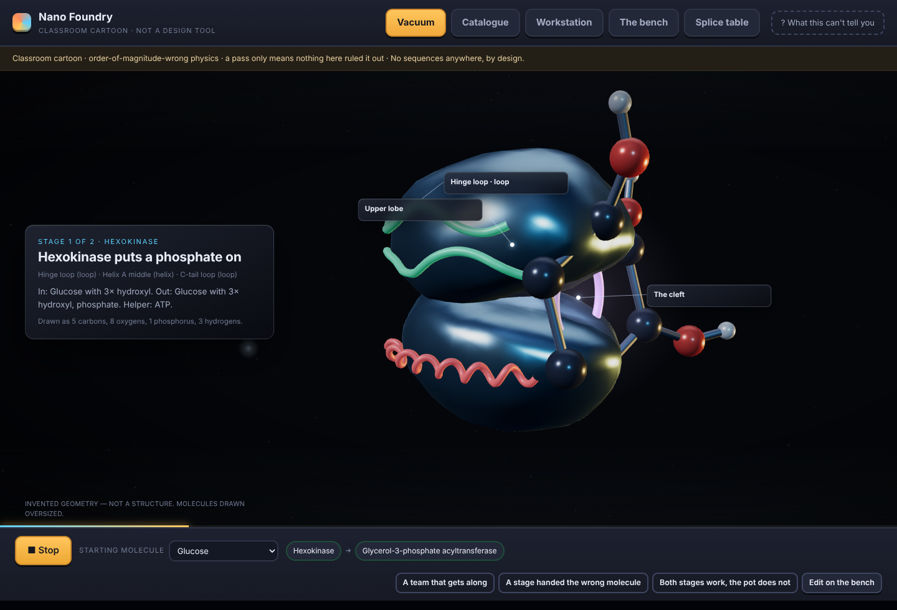
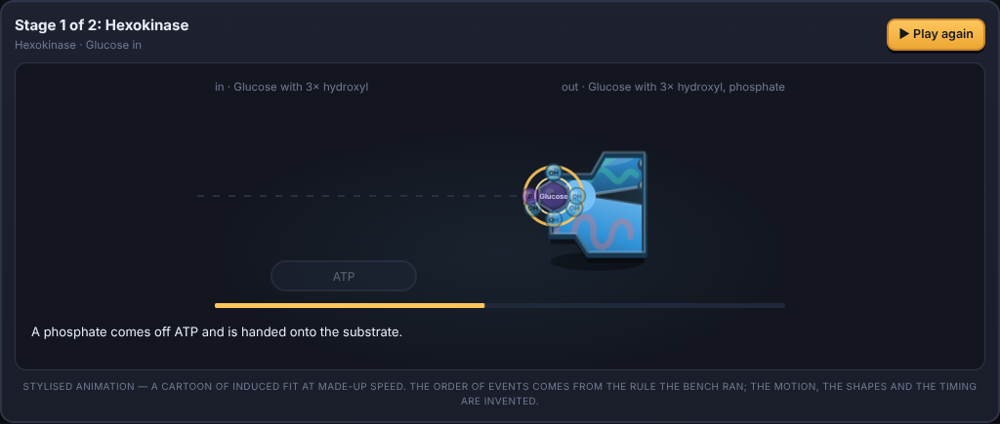
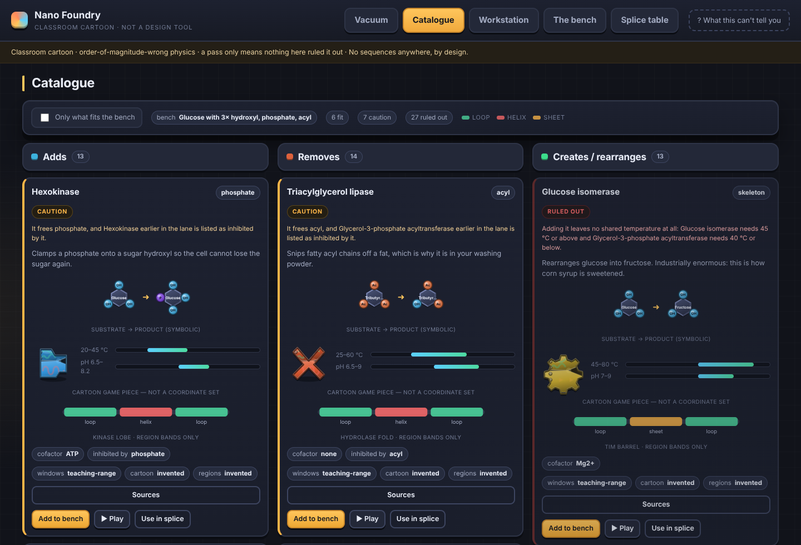
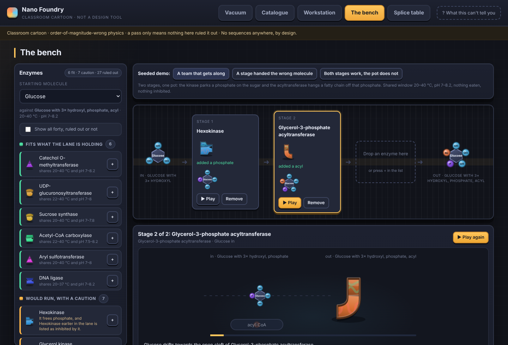
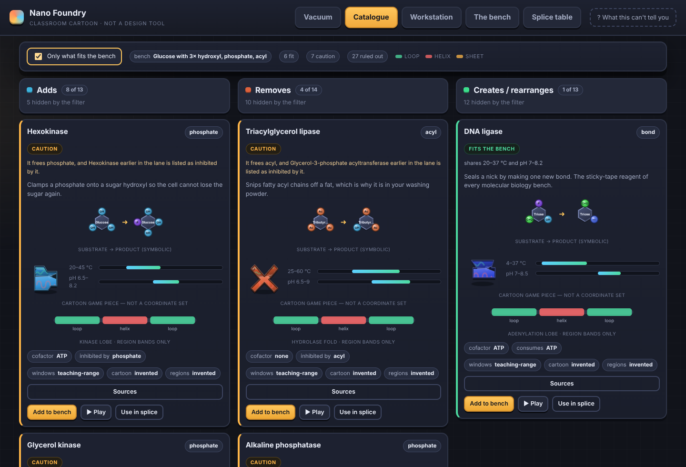
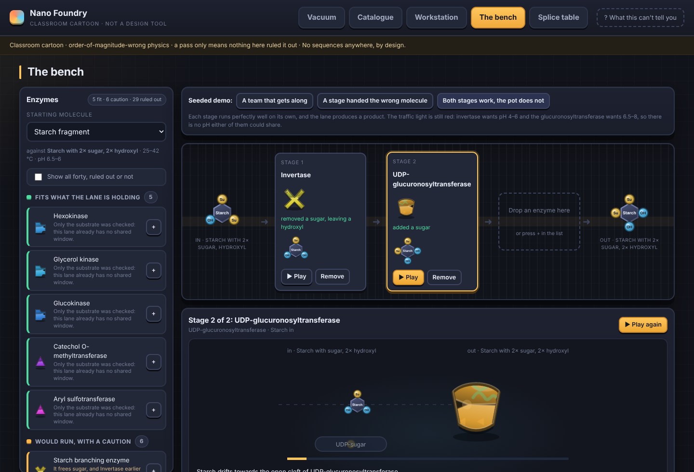
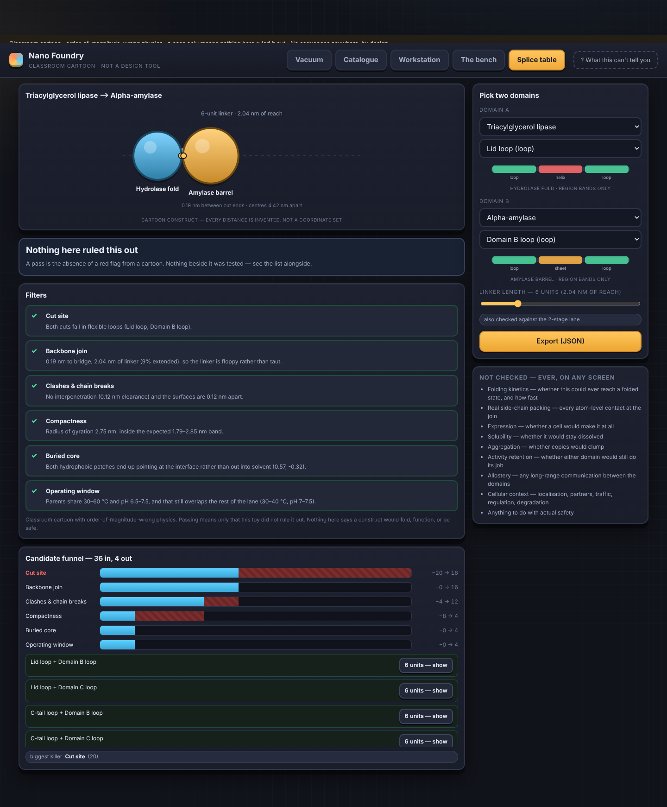
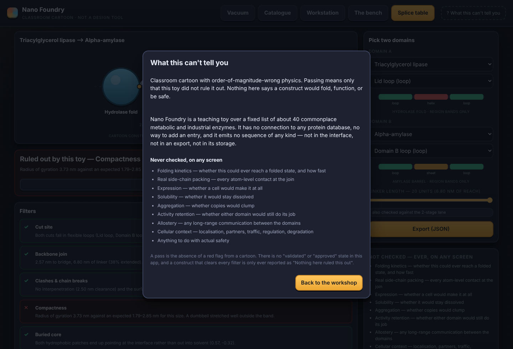

# Nano Foundry

**A classroom sandbox for chaining enzymes together, and a toy "what would break" checker for
hypothetical two-domain constructs.** Built at HackTX 26.

> Live at **nanofoundry.tech** *(domain not registered yet — see `docs/tracks.md`; everything on
> this side is ready for it)*



Nano Foundry is an educational toy. The physics is order-of-magnitude wrong on purpose, the enzyme
catalogue is forty hand-curated commonplace entries committed to this repo, and **the app emits no
sequence of any kind** — not in the interface, not in an export, not in an API response, not in the
database. A construct that clears every filter is reported as *"Nothing here ruled this out"*, never
as anything stronger, with the list of what was never checked standing beside it. The full set of
limits, and how they are enforced in the data layer rather than the copy, is in
[`docs/scope.md`](docs/scope.md).

## Two minutes to running it

```bash
git clone https://github.com/severo126/protein_customizer && cd protein_customizer
./deploy/bring-up.sh          # app + event API on :5173, filter service on :8000
```

That is the whole setup: no install step, no build step, no dependencies to fetch. It uses
TimescaleDB in Docker if Docker is there and a local JSONL buffer if it is not, starts the Python
filter service, seeds the funnel history with a sweep, and prints the URLs. Open
<http://localhost:5173> and press **A team that gets along** on the bench.

```bash
npm test          # 70 JavaScript tests + the Python parity suite
```

## What is in it

**The vacuum** — the home screen. The lane from the bench, run as one chain in a dark metallic 3D
scene: press Play once and each enzyme in turn takes the molecule, acts on it, and hands the product
to the next. Enzyme bodies are invented geometry; molecules are ball-and-stick, with the atoms and
bonds of their composition and drawn positions.

**Catalogue** — forty enzymes in three columns by what they do to a molecule: *adds*, *removes*,
*creates / rearranges*. Each card shows the group it moves, a cartoon of substrate in and product
out, its cofactor, its temperature and pH window, and a schematic loop/helix/sheet domain map. Every
card says which of its numbers came from reference material and which were invented for the cartoon,
and has a button out to real references.

**The bench** — drag enzymes into a lane and watch the molecule change stage by stage. A stage that
has no rule for the previous product shows the mismatch and explains it instead of silently passing
it along. A traffic-light row checks whether the whole team could sit in one pot: overlapping
temperature windows, overlapping pH, whether a stage eats a cofactor a later stage needs, and
whether a later product inhibits an earlier stage. An empty intersection is a hard red naming both
stages that caused it.

**Splice table** — pick a domain and a cut site from each of two entries, choose a linker, and six
hard-reject filters report pass or fail with a reason: cut site, backbone join, clashes and chain
breaks, compactness, buried core, operating window. The funnel shows every candidate splice point
that went in, which filter killed how many, and the few that came out.



| | |
| --- | --- |
|  |  |
|  |  |
|  |  |

## How it is put together

```
src/model/      the filters, the lane and the molecule model, in JavaScript
py/nano_foundry/ the same filters, the same lane, in Python
src/data/       the fixed catalogue, the seeded demo, and the parity contract
src/ui/         the four screens (vanilla ES modules, no build step)
py/service.py   the Python filter + agent API
tools/api/      the event API, the Timescale schema, the sweep and the warehouse export
config/         the agent registry and each agent's instructions
deploy/         one-command bring-up, locally or onto Vultr
```

The filters exist twice, in JavaScript for the browser and in Python behind the API, and
`src/data/parity-cases.json` holds 393 cases — 288 splice candidates, 15 lanes, 90 single stages —
with the expected verdict, the expected numbers and the expected sentence. Both test suites assert
that file, so if one implementation drifts, one suite goes red and names the case. Change a filter
and you regenerate the contract and fix both sides in the same commit.

The model is never in the loop on a verdict. Gemini parses English into a candidate lane and puts a
rejection into plain words; deterministic code decides what runs and what is rejected, which is why
the results are reproducible and testable.

## Scripts

| | |
| --- | --- |
| `npm test` | both suites |
| `npm run test:js` / `npm run test:py` | one at a time |
| `npm run serve` | static server only, no event API |
| `npm run api` | app + event API (`DATABASE_URL` to use Timescale) |
| `npm run filters` | the Python filter service on :8000 |
| `npm run sweep` | seed the funnel history |
| `npm run parity:build` | regenerate the parity contract |
| `npm run snowflake:export` | batch-export the run history |
| `node tools/screenshots.cjs` | regenerate `docs/screenshots/` |

Optional environment: `DATABASE_URL` (Timescale), `SERPAPI_KEY` (citation panel),
`SNOWFLAKE_*` (warehouse load), `VULTR_API_KEY` (provisioning). Everything runs without any of them,
and every panel that needs one says so rather than inventing a result. The Gemini key is pasted into
the browser and stays there.

## Reading on

* [`docs/scope.md`](docs/scope.md) — what this is and is not, and how the limits are enforced
* [`docs/tracks.md`](docs/tracks.md) — what each sponsor service actually does here, and what would
  break without it, including the three that could not earn a role
* [`docs/demo-day.md`](docs/demo-day.md) — the two-minute walkthrough and the track pitches
* [`docs/credentials.md`](docs/credentials.md) — how to get the Vultr, SerpApi and Timescale
  credentials, and what each one turns on

## What this cannot tell you

Folding kinetics. Real side-chain packing. Expression. Solubility. Aggregation. Activity retention.
Allostery. Any cellular context. Anything to do with actual safety. A pass here is the absence of a
red flag from a cartoon, and that list is in the app on every screen, beside the verdict rather than
under it.
